# Investigation Engine

An evidence-driven Python application that searches a versioned document corpus,
follows reasoning links across sources, and produces attributable answers. Every
published claim points to a real passage and an exact quotation. Missing evidence
and unresolved source disagreements are explicit outcomes.

The application includes document management, dense and keyword retrieval, a
custom ranking algorithm, bounded LLM tool calls, a second evidence-verification
pass, an evaluation harness, and a responsive source-inspection interface.

## Run locally

Requirements: Python 3.12, [uv](https://docs.astral.sh/uv/), and internet access for
the initial dependency/model downloads. Docker is optional for local development.

```powershell
uv sync --frozen --extra dev --extra data
Copy-Item .env.example .env
uv run investigate download-models
uv run investigate seed --ingest
uv run investigate serve
```

Open <http://127.0.0.1:8000>. API documentation: <http://127.0.0.1:8000/docs>.
The initial `extractive` setting returns labeled source excerpts without an LLM.
To enable the full investigation workflow, edit the untracked `.env` file:

```dotenv
LLM_PROVIDER=gemini
LLM_MODEL=gemini-3.5-flash-lite
GEMINI_API_KEY=your-key-from-google-ai-studio
```

Restart the application after configuration changes. Model errors are reported;
there is no silent switch from a failed LLM to a successful preview answer.
An optional Ollama adapter supports tool-capable local models via
`LLM_PROVIDER=ollama`, `LLM_MODEL=<installed-model>`, and `OLLAMA_URL`.

Try these seeded questions:

- Which system change caused the Atlas payment delay on March 3, which service was affected, and what confirmed the cause?
- How many failed payment requests did Atlas incident INC-001 have according to both audit exports?
- What was the exact financial loss in dollars from the Atlas incident?

## Required 50,000-record corpus

```powershell
uv run investigate prepare-dataset
uv run investigate ingest data/corpus/hotpot/corpus.jsonl --batch-size 128
uv run investigate status
```

Preparation downloads immutable HotpotQA parquet files, selects 50,000 distinct
source passages, and adds 85 authored incident documents. The resulting manifest
records the upstream revision, sampling seed, licenses, counts, and SHA-256 hashes.
Question/answer labels remain in a separate file and are never indexed as document
text. The combined benchmark has 92 test, 12 tuning, and 4 security questions.

An interrupted import can be replayed. Stable IDs and checksums skip completed
records, and job progress is stored in Qdrant. A final count verifies the stored
corpus; the number of chunks is not used as the document count.

Embedding a large corpus is a CPU batch operation. Run it locally against the
target Qdrant service before deploying the web application. Local embedded Qdrant
allows one process per data directory; stop the web server before an embedded
import, evaluation, or CLI query. Use Qdrant Server/Cloud for concurrent processes.

## Architecture and technical choices

```mermaid
flowchart LR
    Files[PDF / DOCX / TXT / MD / dataset records] --> Parse[Text + source locations]
    Parse --> Version[Checksum + revision + deduplication]
    Version --> Chunk[Model-token-aware chunking]
    Chunk --> Dense[Local ONNX embeddings]
    Chunk --> Sparse[BM25 sparse vectors]
    Dense --> Q[(Qdrant)]
    Sparse --> Q
    UI[Browser UI / REST API] --> Plan[Bounded LLM search plan]
    Plan --> Search[Dense + keyword retrieval]
    Q --> Search
    Search --> Rank[Custom RRF + diversity + reranking]
    Rank --> Follow[Evidence-dependent follow-up tools]
    Follow --> Answer[Structured synthesis]
    Answer --> Verify[Exact citations + independent evidence check]
    Verify --> Result[Cited answer / conflict / abstention]
    Result --> UI
```



FastAPI serves both the API and a lightweight same-origin UI, reducing deployment
and operational overhead. Qdrant stores dense/sparse indexes, extracted documents,
revision publication markers, jobs, and corpus generations. A document revision
becomes visible only after its chunks are stored. Queries filter out unpublished,
deleted, or obsolete chunks.

The retrieval algorithm is implemented in this repository: weighted reciprocal
rank fusion combines incomparable dense/BM25 rankings, adds subquestion coverage,
and applies a soft document-diversity penalty. An ONNX cross-encoder reranks a
bounded candidate set. The sparse representation implements BM25 term-frequency
and length weighting; Qdrant applies collection-level IDF. See
[architecture decisions](docs/ARCHITECTURE.md) for formulas and tradeoffs.

LLM access is a small HTTP adapter rather than an agent framework. The model can
call only validated corpus tools, with bounded arguments, timeouts, and retries.
Retrieved documents cannot grant tool authority. Source quotations must be exact
substrings of active passages; a separate verification call checks whether the
evidence entails the proposed claims. This reduces hallucination risk but does
not prove correctness: the verifier can share the generator's mistakes.

## Evaluate and verify

```powershell
uv run pytest --cov=investigation --cov-report=term-missing
uv run ruff check .
uv run ruff format --check .
uv run mypy src/investigation
uv run investigate evaluate data/corpus/hotpot/cases.jsonl --name hybrid --output reports/evaluation/hybrid
uv run investigate evaluate data/corpus/hotpot/cases.jsonl --mode dense --no-rerank --name dense --output reports/evaluation/dense
uv run investigate compare reports/evaluation/hybrid/results.json reports/evaluation/dense/results.json
uv run investigate benchmark data/corpus/hotpot/cases.jsonl --questions 10 --concurrency 1
```

Evaluation defaults to the held-out `test` split; use `--split security` or
`--split tuning` explicitly. Reports preserve every prediction, citation, trace,
provider/model name, corpus revision, and error. Recall@K, MRR, all-support recall,
citation precision/recall, exact quotation validity, abstention, and contradiction
accuracy are separate measurements. Token F1 and required-fact recall are labeled
lexical diagnostics, not semantic-correctness guarantees.

See the [measured evaluation report](docs/EVALUATION_REPORT.md),
[evaluation methodology](docs/EVALUATION_METHODOLOGY.md),
[experiments](docs/EXPERIMENTS.md), and the generated `reports/` results. Preview
and mocked-provider runs are never reported as real LLM evaluation.

For free-tier runs, the harness saves an atomic checkpoint after each completed
attempt. Use `--max-new-cases 5 --stop-on-error --request-interval-seconds 15`
to work in small paced batches, then repeat the same command with `--resume`.
Choose pacing and batch size from your project's actual quotas; these example
values do not guarantee quota availability. Completed attempts, including errors,
are retained. Partial runs are labeled and cannot pass the final evidence audit.
See [checkpoint and resume rules](docs/EVALUATION_METHODOLOGY.md#checkpointed-free-tier-runs).

## Deployment and submission

The intended free deployment is Render + Qdrant Cloud + Gemini's free API tier.
[`render.yaml`](render.yaml), [`Dockerfile`](Dockerfile), and
[`compose.yml`](compose.yml) are included. All durable source/index state is
external to Render's ephemeral filesystem. Local model caches are disposable.

Follow the exact [account setup and deployment guide](docs/DEPLOYMENT.md). A live
URL and a GitHub repository must be created and checked before submission; code
or a deployment manifest alone does not meet that requirement. Final evidence is
tracked in [the requirement matrix](docs/REQUIREMENTS.md).

Submission material:

- [Measured evaluation report](docs/EVALUATION_REPORT.md), [methodology](docs/EVALUATION_METHODOLOGY.md) and generated reports.
- [AI usage report](docs/AI_USAGE_REPORT.md), including candidate review obligations.
- [API reference](docs/API.md), [demo script](docs/DEMO_SCRIPT.md), and [interview guide](docs/INTERVIEW_GUIDE.md).

## Boundaries and resource limits

- Initial benchmark and embedding/reranker models target English. Unicode text is
  accepted, but Georgian retrieval quality has not been established by this benchmark.
- Scanned PDFs without a text layer are rejected with a clear OCR-needed message.
  Uploaded originals are not retained; extracted text, locations, and revisions are.
- The public deployment is a shared demonstration corpus. Do not upload private
  material. Management requires an admin token in production; reads are public.
- Streaming sends stage progress, text fragments from the validated answer, and
  its structured final object. It does not reduce provider generation latency.
- Free hosting may sleep, restart, or reach quotas. The deployment guide records
  these constraints, memory checks, backups, and recovery instructions.
- The hash embedder is an explicitly marked test double and is forbidden in
  production. Real semantic-search experiments use downloaded ONNX models.

## Attribution

[HotpotQA](https://huggingface.co/datasets/hotpotqa/hotpot_qa) is used under its
dataset's CC-BY-SA-4.0 terms; underlying Wikipedia attribution and source URLs are
preserved. Authored synthetic incident fixtures are marked separately as CC0-1.0.
Model names/licenses and exact dataset revision are recorded in manifests and
reports. See [third-party notices](THIRD_PARTY_NOTICES.md).
